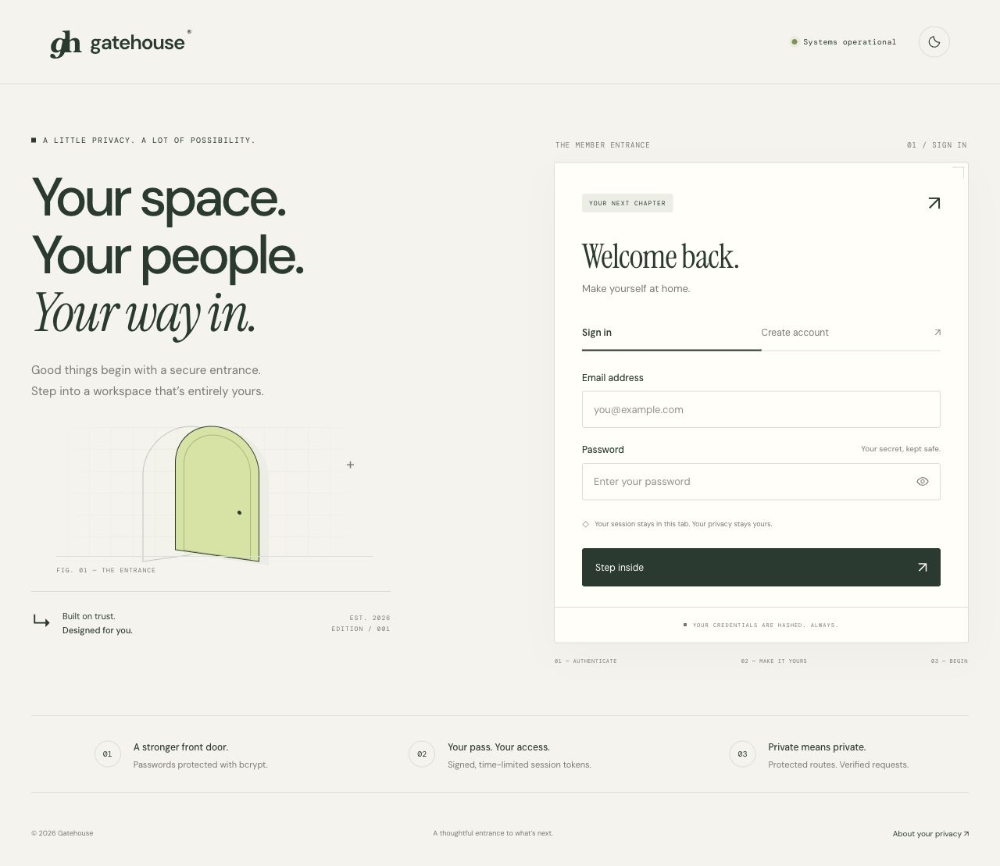
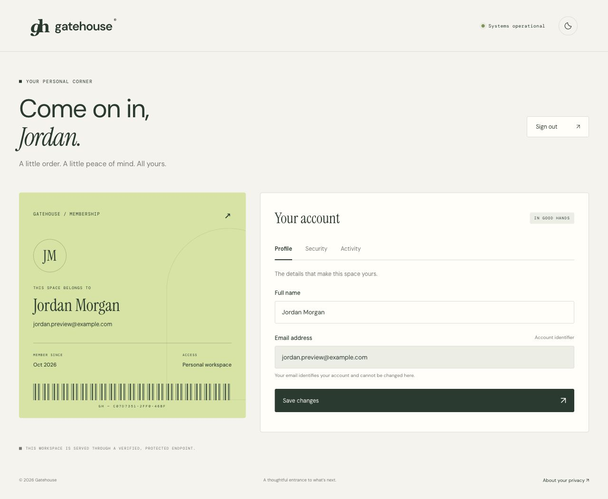
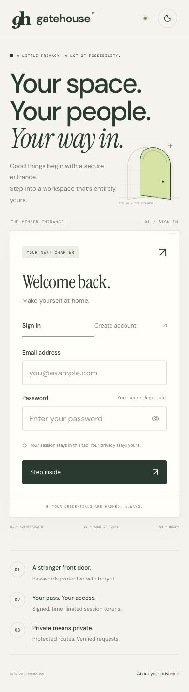
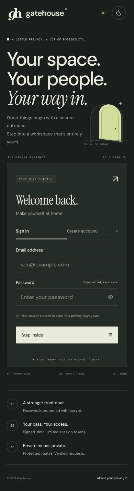
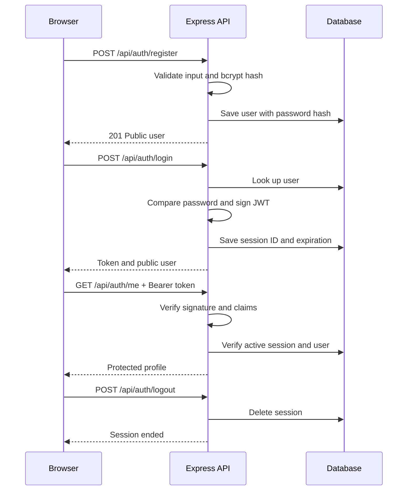

<div align="center">


# Gatehouse

### Your space. Your people. Your way in.

A complete JWT authentication application with a quiet editorial interface,<br>an individual member pass, and security built into every request.

[Live demo](https://gatehouse-rachit.onrender.com) · [GitHub repository](https://github.com/rachit1807/Gatehouse) · [API reference](#api-reference) · [Run locally](#run-locally)


<br><br>


</div>



## A considered entrance

Gatehouse implements **Week 5 · Task 1 — User Authentication with JWT**. Users can create an account, sign in, enter a protected member workspace, update their profile, change their password, review recent activity, and sign out.

The interface uses warm paper, forest green, lime accents, serif display typography, and an architectural doorway illustration. The authenticated workspace replaces the entrance with a personal membership pass and account settings.

### What’s included

- **Registration:** validated names, normalized email addresses, duplicate detection, and bcrypt password hashing with a cost of 12.
- **Authentication:** signed JWT access tokens with explicit algorithm, issuer, audience, subject, session ID, and expiration checks.
- **Protected workspace:** authenticated profile and activity endpoints; no password hash returned to the client.
- **Session control:** one-hour tokens by default, server-side session revocation on logout, and all sessions invalidated on password change.
- **Account settings:** edit your display name, change your password with current-password verification, and view your latest 12 account events.
- **Responsive design:** layouts for mobile, tablet, and desktop; labeled forms, visible keyboard focus, keyboard-operated tabs, and accessible status messages.
- **Light and dark themes:** follows the system preference initially and saves your chosen theme locally.
- **Polished forms:** show/hide password, registration strength feedback, busy states, validation, and connection-error feedback.
- **Durable storage:** local SQLite for an easy start; PostgreSQL with a dedicated schema for deployment.
- **Security defaults:** Helmet headers, a restrictive content security policy, authentication rate limits, bounded request bodies, and non-cacheable account responses.

## Preview

<details>
<summary><strong>Dark mode</strong></summary>


</details>

<details>
<summary><strong>Member workspace</strong></summary>



</details>

<details>
<summary><strong>Mobile light and dark</strong></summary>

<p align="center">


</p>

</details>

## Technology

| Layer | Technology | Purpose |
| --- | --- | --- |
| Server | Node.js 24, Express 5 | HTTP API and same-origin static frontend |
| Credentials | bcryptjs | Salted password hashing, cost 12 |
| Tokens | jsonwebtoken | HS256 signing and verified JWT claims |
| Configuration | dotenv | Local environment configuration |
| Security | Helmet, express-rate-limit | Response headers and authentication throttling |
| Storage | SQLite / PostgreSQL (`pg`) | Users, revocable sessions, and account events |
| Interface | HTML, CSS, JavaScript | Responsive UI without a frontend build step |
| Testing | Node test runner, Supertest | Authentication integration tests |
| Automation | GitHub Actions | Repeatable checks on pushes and pull requests |

## Run locally

**Requirements:** Node.js **24 LTS** (Node 22.13+ is supported) and npm. A database server is **not required** for local development.

```bash
git clone https://github.com/rachit1807/Gatehouse.git
cd Gatehouse
npm ci
cp .env.example .env
```

Generate a secret:

```bash
node -e "console.log(require('crypto').randomBytes(48).toString('hex'))"
```

Paste the output into `.env` as `JWT_SECRET`, replacing the example value, then start:

```bash
npm run dev
```

Open **http://localhost:3000**. Create an account, then sign in. SQLite automatically creates its database at `data/gatehouse.sqlite`.

> If port 3000 is already in use, set `PORT=3217` in `.env` and open http://localhost:3217 instead. Local development generates a temporary secret if none is set; restarting then invalidates existing JWTs. Use a configured random secret for repeatable local sessions.

### Commands

| Command | What it does |
| --- | --- |
| `npm run dev` | Starts the API with Node’s server-file watcher |
| `npm start` | Starts the application |
| `npm test` | Runs isolated authentication integration tests |

Frontend files are served directly; refresh the browser after editing them.

## Environment configuration

| Variable | Default | Description |
| --- | --- | --- |
| `PORT` | `3000` | HTTP listening port; production binds to `0.0.0.0` |
| `NODE_ENV` | development behavior | Set to `production` on the host |
| `JWT_SECRET` | temporary random secret in development | Random signing secret, at least 32 characters in production |
| `JWT_EXPIRES_IN` | `1h` | JWT lifetime, e.g. `30m` or `1h` |
| `DATABASE_URL` | unset | PostgreSQL connection URL; required in production |
| `DATABASE_SCHEMA` | `gatehouse` | PostgreSQL schema; lowercase SQL identifier |
| `DATABASE_PATH` | `./data/gatehouse.sqlite` | Local SQLite path; ignored when PostgreSQL is configured |

Never commit `.env`, database files, tokens, or connection URLs. The repository includes `.env.example` with configuration names only.

## Authentication flow



JWT identity is verified on every protected request. A stored session ID additionally enables immediate logout and password-change revocation. This deliberately adds server-side state for revocation; it is not a purely stateless authentication design.

## API reference

All requests and responses use JSON. Protected routes require `Authorization: Bearer <token>`.

| Method | Endpoint | Access | Purpose |
| --- | --- | --- | --- |
| `GET` | `/api/health` | Public | Service and database readiness |
| `POST` | `/api/auth/register` | Public | Register with `name`, `email`, `password` |
| `POST` | `/api/auth/login` | Public | Sign in with `email`, `password` |
| `GET` | `/api/auth/me` | Protected | Get current public user |
| `PATCH` | `/api/auth/profile` | Protected | Update `name` |
| `GET` | `/api/auth/activity` | Protected | Latest 12 account events |
| `POST` | `/api/auth/password` | Protected | Submit `currentPassword`, `newPassword` |
| `POST` | `/api/auth/logout` | Protected | Revoke current session |

### Try the API with cURL

```bash
BASE_URL=http://localhost:3000

# 1. Register — expected 201
curl -i "$BASE_URL/api/auth/register" \
  -H 'Content-Type: application/json' \
  -d '{"name":"Alex Morgan","email":"alex@example.com","password":"Unique-demo-pass-42!"}'

# 2. Sign in — expected 200 with a token
curl -s "$BASE_URL/api/auth/login" \
  -H 'Content-Type: application/json' \
  -d '{"email":"alex@example.com","password":"Unique-demo-pass-42!"}'

# Copy the token from the login response; keep it private.
TOKEN='paste-your-token-here'

# 3. Protected profile — expected 200
curl -i "$BASE_URL/api/auth/me" -H "Authorization: Bearer $TOKEN"

# 4. Missing token — expected 401
curl -i "$BASE_URL/api/auth/me"

# 5. Invalid token — expected 401
curl -i "$BASE_URL/api/auth/me" -H 'Authorization: Bearer invalid-token'

# 6. Save profile — expected 200
curl -i -X PATCH "$BASE_URL/api/auth/profile" \
  -H "Authorization: Bearer $TOKEN" -H 'Content-Type: application/json' \
  -d '{"name":"Alex Taylor"}'

# 7. View activity — expected 200
curl -i "$BASE_URL/api/auth/activity" -H "Authorization: Bearer $TOKEN"

# 8. Sign out — expected 200
curl -i -X POST "$BASE_URL/api/auth/logout" -H "Authorization: Bearer $TOKEN"

# 9. Reuse revoked token — expected 401
curl -i "$BASE_URL/api/auth/me" -H "Authorization: Bearer $TOKEN"
```

Registration returns a public user and requires a subsequent login. A successful login returns:

```json
{
  "token": "<signed-jwt>",
  "tokenType": "Bearer",
  "expiresAt": "<ISO-8601 timestamp>",
  "user": {
    "id": "<uuid>",
    "name": "Alex Morgan",
    "email": "alex@example.com",
    "createdAt": "<ISO-8601 timestamp>"
  }
}
```

### Validation and errors

- Names: 2–60 characters after trimming.
- Emails: basic format validation, maximum 254 characters, stored lowercase.
- New passwords: at least 8 characters and at most **72 UTF-8 bytes** to avoid bcrypt truncation.
- Authentication attempts: a shared IP-based limit of 30 requests per 15 minutes across registration, login, and password changes. A `429` response asks the caller to retry later.
- Statuses: `400` invalid input/JSON, `401` invalid credentials/session, `409` duplicate email, `413` oversized body, `429` rate limit, `500` unexpected server error.
- Error responses have the form `{ "message": "Human-readable description." }`.

## Project structure

```text
Gatehouse/
├── .env.example
├── .github/workflows/test.yml
├── docs/                         # Verified UI screenshots
├── public/
│   ├── index.html                # Entrance and protected workspace UI
│   ├── style.css                 # Responsive light/dark design
│   ├── app.js                    # Forms, API client, account interactions
│   ├── favicon.svg
│   └── fonts/                    # Self-hosted typefaces and licenses
├── src/
│   ├── app.js                    # Express setup and error handling
│   ├── config.js                 # Validated configuration
│   ├── server.js                 # Listener and graceful shutdown
│   ├── controllers/authController.js
│   ├── middleware/authMiddleware.js
│   ├── models/store.js           # PostgreSQL/SQLite persistence
│   └── routes/authRoutes.js
├── test/auth.test.js
├── package.json
└── package-lock.json
```

## Verification

`npm test` runs **seven integration tests** against an isolated, in-memory SQLite database. Coverage includes:

1. Registration validation, duplicate email detection, hash format, and secret-free responses.
2. Incorrect credentials, successful login, JWT signature and expiration.
3. Missing, malformed, forged, expired, and wrong-audience tokens.
4. Protected profile edits and account activity.
5. Immediate revocation after logout.
6. Current-password verification and all-session revocation after password change.
7. Database readiness, static page delivery, CSP headers, malformed JSON, and missing API routes.

Browser checks cover registration, login, profile edits, activity, logout, light/dark themes, and a 390px mobile viewport. Live PostgreSQL smoke checks passed on 29 October 2026 for database readiness, registration, login, protected access, profile updates, activity, logout, and rejection of a revoked token.

## Deployment

**Live application:** [gatehouse-rachit.onrender.com](https://gatehouse-rachit.onrender.com)

The application runs as a free Render Node web service in Singapore, backed by its own **Neon PostgreSQL 16 project** in Singapore. Gatehouse has an independent database and role, with application tables in the `gatehouse` schema; it does not share a database with other projects. The `production` branch has no scheduled expiration. Free-plan quotas and provider terms still apply, and the free web service may take time to wake after inactivity.

The server uses a direct TLS database connection and a five-connection application pool because schema initialization and `search_path` rely on session settings. Keep the connection URL and JWT signing secret exclusively in the hosting environment.

### Reproduce the deployment

Deploy as a **Node web service**, serving frontend and API from the same origin:

1. Connect this repository to your host and select `main`.
2. Use Node.js **24**, build command `npm ci --omit=dev`, and start command `npm start`.
3. Set `NODE_ENV=production`, a random `JWT_SECRET`, `JWT_EXPIRES_IN=1h`, and `DATABASE_URL`.
4. Set `DATABASE_SCHEMA=gatehouse` to isolate application tables within PostgreSQL.
5. If supported, configure the HTTP health check as `/api/health`.
6. Deploy, check `/api/health`, and verify registration, login, protected access, and logout.

The PostgreSQL role must be allowed to create the selected schema and its tables. The app creates its schema and tables on startup. SQLite is intentionally disallowed in production, avoiding accidental data loss on ephemeral hosting filesystems.

### Security and scope

Gatehouse is an educational authentication application. It does not include email verification, password recovery, MFA, OAuth, or refresh-token rotation. Password recovery is deliberately absent until a real email service can verify account ownership.

Tokens are stored in **tab-scoped `sessionStorage`**, not localStorage. This limits persistence, but JavaScript on the origin can still read them; CSP and safe DOM updates help reduce XSS exposure. Closing a tab clears its token copy; explicit logout revokes the corresponding server session. Session records and events live in the database. Expired sessions are pruned on login.

IP rate limits use an in-memory store and reset when the process restarts. Before scaling across multiple application instances, use a shared rate-limit store. Render deployment assumes one trusted reverse-proxy hop. Other hosts should review that setting.

## Credits

Full-Stack Web Development program · Week 5, Task 1 · **Rachit Tripathi**.

DM Sans, DM Mono, and Instrument Serif are self-hosted under the SIL Open Font License; license files are included in `public/fonts/`. README technology icons are provided by [Skill Icons](https://skillicons.dev).

## Implementation challenges

- **Password handling:** bcrypt’s 72-byte limit required byte-aware validation in addition to a minimum password length.
- **Session lifecycle:** JWT signature checks alone do not revoke a logged-out token. Database-backed session IDs make logout immediate and invalidate all sessions after password changes.
- **Form transitions:** browser testing revealed a loading-state bug that removed the submit button’s child elements; preserving its structure fixed the registration-to-login transition.
- **Responsive themes:** both the entry layout and membership pass needed separate mobile arrangements and readable light/dark color palettes.
- **Deployment storage:** local SQLite is convenient for development, but production requires PostgreSQL to survive redeploys. The live release uses an independent Neon PostgreSQL project, keeping Gatehouse data separate from older applications.
